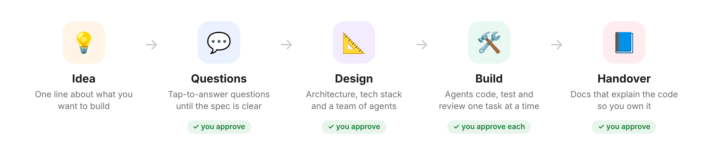
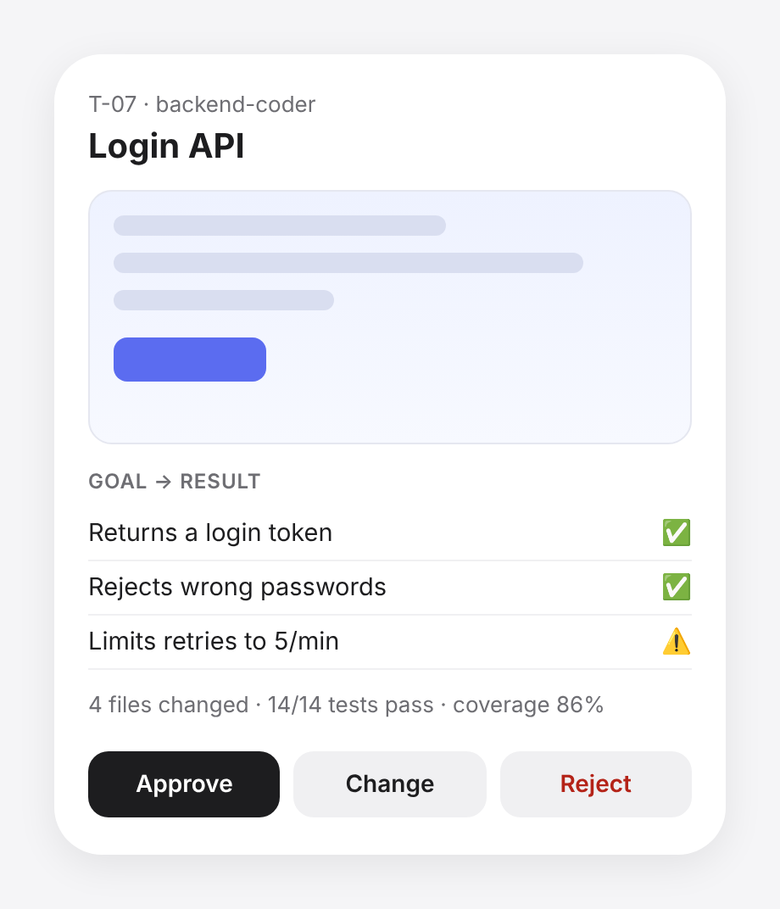

# dev-team-setup

Turn an idea into a working project with a team of AI agents.
You answer questions and approve each step, from your laptop or your phone.



---

## Get started

**0. Check the requirements**

| You need | Why |
|---|---|
| [Claude Code](https://claude.com/claude-code) 2.1.271 or later (terminal, desktop app, IDE or claude.ai/code) | runs the plugin (older versions can't load its settings' choice lists). Not claude.ai chat: it can't run agents or hooks, so the plugin stops there. Cowork loads both but is untested |
| `git` | every task is a branch with checkpoints |
| [GitHub CLI](https://cli.github.com) `gh`, signed in (`gh auth login`) | creates the project's repo and pushes to it |
| Python 3.9 or newer (`python3`) | the guard that keeps each agent in its lane runs on it |
| [uv](https://docs.astral.sh/uv/) | Python projects |
| Node.js + npm | JavaScript projects and Mermaid diagrams |

One line to check them all:

```bash
git --version && gh auth status && python3 --version && uv --version && npm --version
```

Playwright and Chromium (for screenshots) are set up the first time you start a project: the
plugin asks first, and installs them into its own private folder, not your system Python.

**1. Install** in Claude Code

```bash
claude plugin marketplace add AbrahamLinksus/dev-team-setup
claude plugin install dev-team-setup@dev-team-setup
```

**2. Add your details:** Claude Code asks for your name and GitHub username when the plugin is
enabled. To change them later, run `/plugin configure dev-team-setup@dev-team-setup`, or open
`/config`, where each option has its own row.

**3. Start a project**

```
/setup-project a habit tracker with daily streaks
```

Claude checks the tools above, asks you a few questions, plans the project, picks a team of
agents, and starts building.

---

## What you'll do

Mostly tap buttons. After every task you get a result like this:



*Illustration: each result shows what the task was meant to do, what got done, and a screenshot.*

**Approve** saves it to your repo · **Change** sends it back with your note · **Reject** throws it away.

---

## What this plugin runs and sends

Everything runs on your machine, in your Claude Code session. The plugin has no server and
no telemetry. It sends nothing anywhere except what is listed here.

| What | When | Where it goes |
|---|---|---|
| Creates a GitHub repo (`gh repo create`), private or public as you choose | Once, at the start of a project | GitHub, under the account you set as `github_owner` |
| Pushes commits: `main` and one `wip/<task>` branch per task, after every step | Throughout the build, so work survives a closed session | That repo |
| Installs the project's own dependencies (`uv sync`, `npm ci`, …) | When a task starts in its own worktree | Package registries (PyPI, npm); files stay in the project folder |
| Installs Playwright, Chromium, Pillow and `mermaid@11.4.1` for screenshots and diagrams | Only when you say yes to `capture.py doctor --install` | Into the plugin's private data folder, not your system Python |
| Shows each working agent's task, step, time and tokens in Claude Code's agent panel (`settings.json` → `hooks/subagent_status.sh`) | While agents run | Nowhere: it formats what Claude Code passes it |
| Starts a headless browser on `localhost` | To screenshot each result | Nowhere: local pages only |
| Fetches web pages and searches the web | Only the researcher, rag-engineer, agent-engineer and data-acquisition agents, and only when the plan picks them | The sites they read |
| Reads Google Drive files | Only the data-acquisition agent, only if you connected Google Drive and point it at a file | Read-only |

**The guard.** A hook (`hooks/scope_guard.sh`, which runs `hooks/scope_guard.py`) checks every
file edit and shell command made by the plugin's own agents, and blocks anything outside that
agent's role: for example, the tester can't edit app code, and no agent can read `.env` files,
push to `main`, or delete outside the project. It runs locally, makes no network calls, and
ignores tools used outside the plugin's agents. Each block is noted in `.git/devteam-guard.log` (local, never
pushed) so the result card can tell you about it. When it can't run (no Python 3.9+), it blocks
the agent's action rather than letting it through. The full rules are in
[how it works](docs/how-it-works.md).

---

## Good to know

- **Take a break anytime.** Continue later, on any device:
  ```
  /setup-project resume <repo-name>
  ```
- **Changed your mind?** Just say it, e.g. *"make it work offline"*. The plan updates and you approve the change.
- **Your code, your repo.** Each project gets its own GitHub repo. You choose private or public.
- **You own the result.** It ends with docs that walk you through the code.

---

## Settings

Pick these when Claude Code asks after you enable the plugin, or change them later in `/config`.

| Setting | Default | What it does |
|---|---|---|
| `approval_mode` | `every-task` | Set `batch-low-risk` to approve small, safe tasks together |
| `cost_mode` | `quality` | Set `balanced` to use cheaper models where it's safe |
| `budget_usd` | `0` (no cap) | Spend at which it pauses and asks. Every result also shows that task's cost and the total so far |

---

## Learn more

- [How it works](docs/how-it-works.md): the agents, the guardrails, the files each project gets
- [Guardrails](docs/guardrails.md): what each agent may and may not touch, enforced by a hook, and the
  20 bypasses found and closed, each kept by a named test
- [Example run](examples/todo-app/): real planning output for a small todo app, from an early
  version (v0.2: planning stages only)
- **Benchmark:** `python3 bench.py all` compares a normal Claude Code session with the plugin
  (tokens, cost, your effort, and whether the app works). One file, no setup.

**Contributing:** run the tests before you push.

```bash
python3 -m unittest discover -s tests   # needs pyyaml
bash tests/test_taskgit.sh
```
