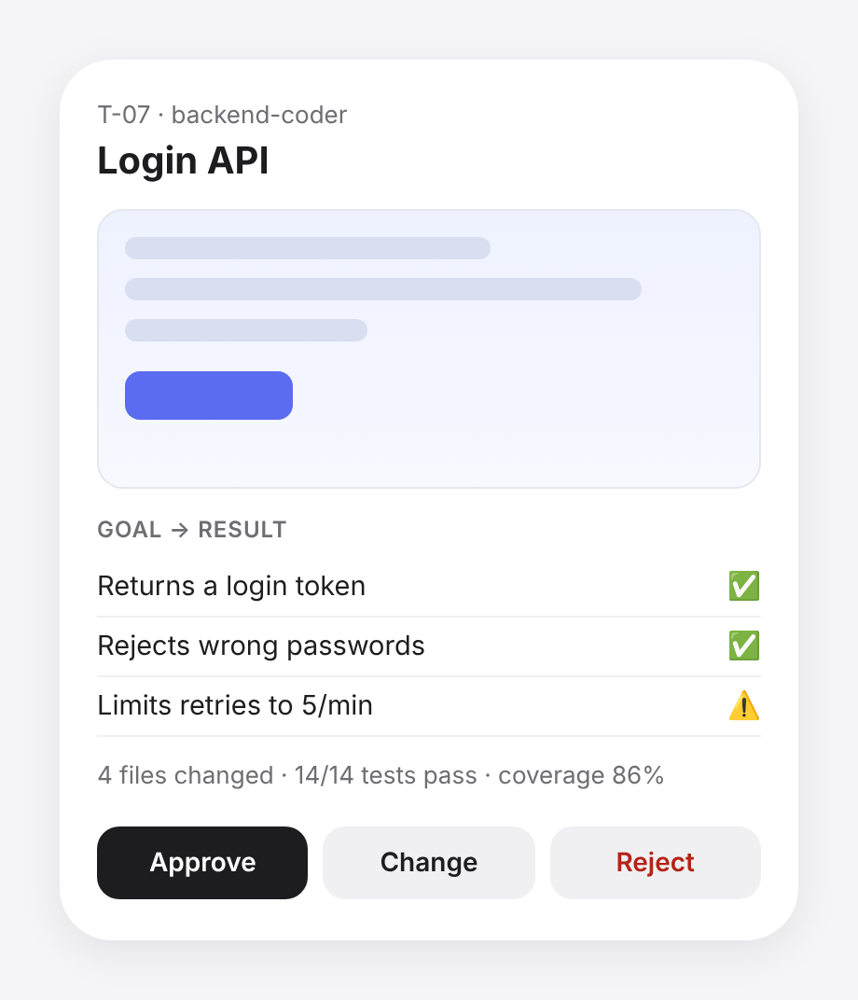

# dev-team-setup

**You bring the idea. A team of AI agents brings the spec, the code, the tests and the docs,
and checks with you before anything important.**

A Claude Code plugin. Type `/setup-project <your idea>`, answer a few questions, and approve
each step (from your laptop or your phone) while the team builds it.


## Why not just ask one chat to build it?

You can. It's great for a quick prototype. Then you start using the thing, and:

| One chat says… | Then you find out… | dev-team-setup instead… |
|---|---|---|
| "Done! Here's your recipe app" | it never saves a backup, and "1–2 cloves" breaks the scaler | interviews you first, and a critic agent pokes holes in the plan before any code exists |
| "I went with Postgres and a hosted API" | that was a big decision you never got to make | stops and asks, in plain words: what it means for you and what changing it later would cost |
| "All working!" | nothing was tested, and one fix broke two other things | tests, reviews and merges every task on its own branch, and you approve it after trying it |
| "I updated a few files" | it edited half the project, including things it shouldn't touch | gives each agent its own job and files, and a guard blocks everything else |
| "Here's the code" | there's no README, no CI, and you're not sure it's safe to use | checks a production list for your kind of app and hands over docs plus a one-page owner guide |

## What it feels like

You mostly tap buttons. After each task you get a card like this:



It says what the task was meant to do, what got done, what it cost, and how to **try it
yourself in a minute**. Then: **Approve**, **Change** or **Reject**. Close your laptop halfway
through and pick it up later with `/setup-project resume <repo>`.

## What you need

| You need | Why |
|---|---|
| [Claude Code](https://claude.com/claude-code) 2.1.271 or later (terminal, desktop app, IDE or claude.ai/code) | runs the plugin. Not claude.ai chat: it can't run agents or hooks |
| `git` | every task is a branch with checkpoints |
| Python 3.9 or newer (`python3`) | runs the guard that keeps each agent in its lane |
| [GitHub CLI](https://cli.github.com) `gh`, signed in (`gh auth login`) | creates the project's repo. Optional: pick **Try locally** to keep everything on your computer |
| [uv](https://docs.astral.sh/uv/) | Python projects |
| Node.js + npm | JavaScript projects and Mermaid diagrams |

Check them all at once:

```bash
git --version && gh auth status && python3 --version && uv --version && npm --version
```

**Installed for you, when you agree:** Playwright, Chromium, Pillow and Mermaid, for
screenshots and diagrams. The plugin asks first and keeps them in its own private folder, not
your system Python. Each project's own dependencies go into that project.

## Install

1. **Add the plugin** in Claude Code:

   ```bash
   claude plugin marketplace add AbrahamLinksus/dev-team-setup
   claude plugin install dev-team-setup@dev-team-setup
   ```

2. **Tell it who you are.** Claude Code asks for your name, your GitHub username and a few
   settings when the plugin is enabled. Change them any time with
   `/plugin configure dev-team-setup@dev-team-setup`, or in `/config`.

3. **Give it an idea:**

   ```
   /setup-project a habit tracker with daily streaks
   ```

To update later: `claude plugin marketplace update dev-team-setup`, then
`claude plugin update dev-team-setup@dev-team-setup`.

More: [how it works](docs/how-it-works.md) · [guardrails](docs/guardrails.md) ·
[privacy: what it runs and sends](docs/PRIVACY.md)
