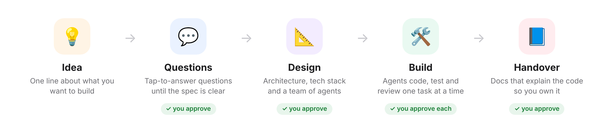

# dev-team-setup

A Claude Code plugin that turns an idea into a working project with a team of AI agents.
You type `/setup-project <your idea>`, answer a short interview, and approve each step while
the agents design, build, test and document it.



## What problem it solves

Asking an AI to "build me an app" in one chat works for a quick prototype, but it falls apart
for anything you want to keep:

- **Nobody pins down what to build.** Gaps (backups, edge cases, what happens on errors) show
  up only once you use the app. Here an interview and a critic agent turn the idea into a clear
  spec first.
- **Big decisions get made silently.** Databases, paid services, what goes online: here every
  one of those stops and asks you, in plain words, with what it means and what changing it
  later would cost.
- **Nothing checks the work.** Here every task is tested, reviewed and merged on its own
  branch, and you approve it after trying it ("Try this" steps and screenshots).
- **One agent can touch anything.** Here each agent is limited to its own role and files by a
  guard, and the project survives a closed laptop (`/setup-project resume <repo>`).
- **"Done" means a demo.** Here the handover checks a production list for your kind of app and
  gives you as-built docs and a one-page owner guide.

## Requirements

| You need | Why |
|---|---|
| [Claude Code](https://claude.com/claude-code) 2.1.271 or later (terminal, desktop app, IDE or claude.ai/code) | runs the plugin. Not claude.ai chat: it can't run agents or hooks |
| `git` | every task is a branch with checkpoints |
| Python 3.9 or newer (`python3`) | runs the guard that keeps each agent in its lane |
| [GitHub CLI](https://cli.github.com) `gh`, signed in (`gh auth login`) | creates the project's repo. Optional: pick **Try locally** to keep everything on your computer |
| [uv](https://docs.astral.sh/uv/) | Python projects |
| Node.js + npm | JavaScript projects and Mermaid diagrams |

Check them all at once:

```bash
git --version && gh auth status && python3 --version && uv --version && npm --version
```

**Installed for you, when you agree:** Playwright, Chromium, Pillow and Mermaid, for
screenshots and diagrams. The plugin asks the first time and puts them in its own private
folder, not your system Python. Each project's own dependencies are installed into that
project as it's built.

## Install

1. **Add the plugin** in Claude Code:

   ```bash
   claude plugin marketplace add AbrahamLinksus/dev-team-setup
   claude plugin install dev-team-setup@dev-team-setup
   ```

2. **Add your details.** Claude Code asks for your name, your GitHub username and a few settings
   when the plugin is enabled. To change them later, run
   `/plugin configure dev-team-setup@dev-team-setup`, or open `/config`.

3. **Start a project:**

   ```
   /setup-project a habit tracker with daily streaks
   ```

To update later: `claude plugin marketplace update dev-team-setup`, then
`claude plugin update dev-team-setup@dev-team-setup`.

More: [how it works](docs/how-it-works.md) · [guardrails](docs/guardrails.md) ·
[privacy: what it runs and sends](docs/PRIVACY.md)
