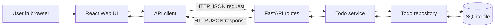
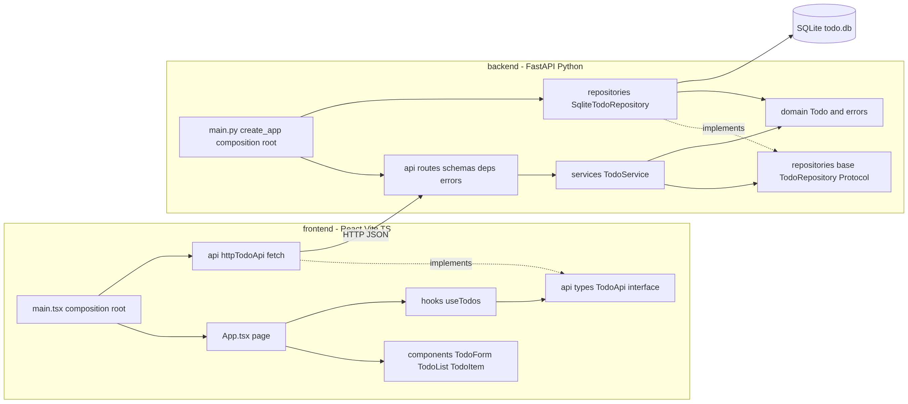
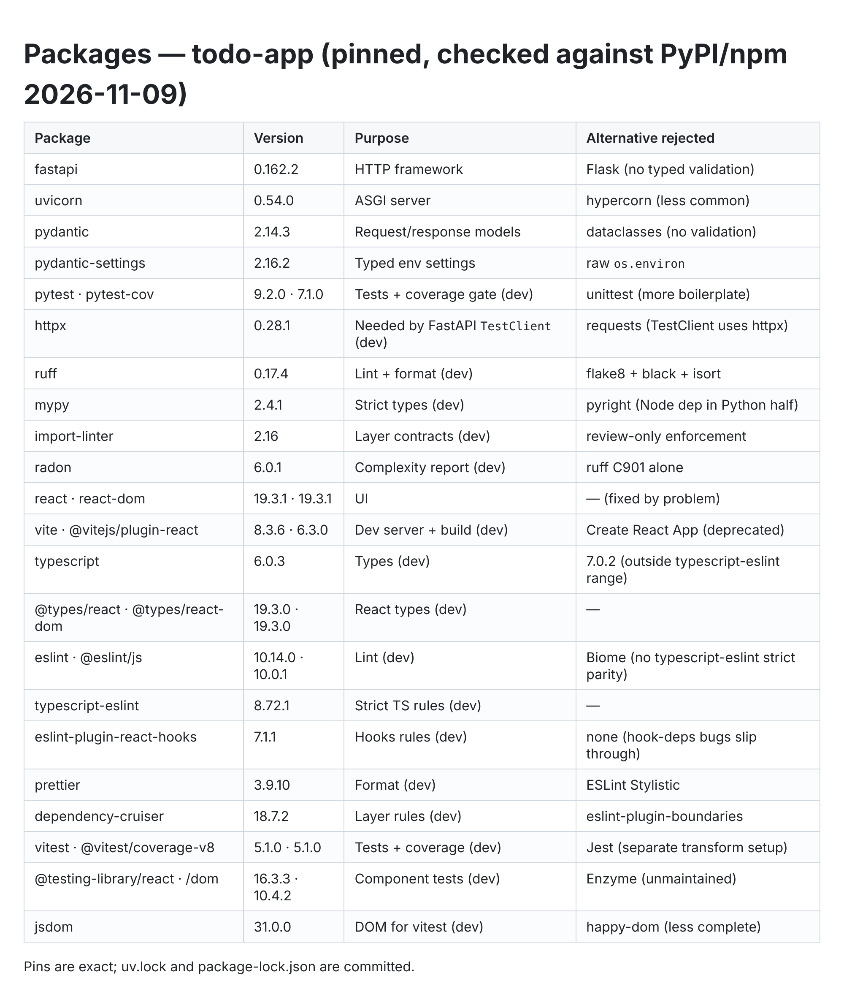
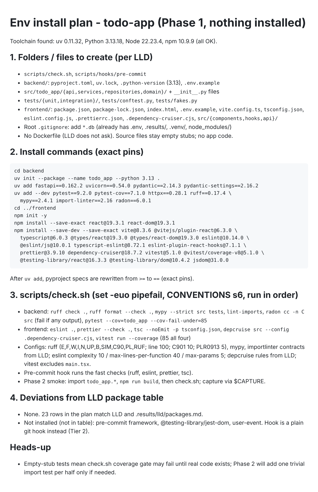

# Example: todo-app (planning stages)

Real output from a `/setup-project` dry run (plugin v0.2): a single-user todo app with a
FastAPI + SQLite backend and a React + Vite + TypeScript frontend. Nothing here was edited
by hand except replacing the owner's name.

| File | Produced by | Stage |
|---|---|---|
| `docs/HLD.md` | planner (Opus) | High-level breakdown, approved |
| `docs/LLD.md` | architect (Opus) | Low-level design + pinned package table, approved |
| `docs/CONVENTIONS.md` | architect (Opus) | Layering, SOLID rules, limits, `check.sh` contents |
| `DECISIONS.md` | Orchestrator | The owner's Tier 1 answers (4 decision cards + LLD approval) and agents' Tier 2 lines |
| `images/` | `capture.py` | The visuals sent to the owner's phone at each checkpoint |

What the owner saw at each checkpoint:

| HLD card | LLD card | Install card |
|---|---|---|
|  |   |  |

Not included: the spec stage (added in v0.4, after this run), the environment install,
and the build/handover stages. The dry run was paused at the install step to fix the
issues it surfaced, so this example shows the planning artefacts only.
