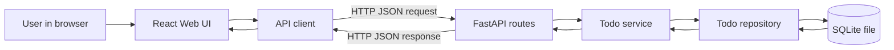

# High-level design — todo-app

## Problem & goal
A single user needs a simple place to track things to do. Goal: a local web app where the user can add, see, complete and remove todos, with data kept between restarts.

## Users & main use cases
One local user (no accounts).
1. Create a todo by typing a title.
2. List all todos, showing which are done.
3. Mark a todo done, or back to undone.
4. Delete a todo.

## Scope
- In: the 4 use cases above; FastAPI REST backend; SQLite file storage; React (Vite + TypeScript) single-page UI; README with run steps.
- Out: auth / multiple users, deployment and hosting, due dates, tags, priorities, editing titles, search, mobile app.

## Success metrics
- All 4 use cases work end to end in the browser against the real backend.
- Todos survive a backend restart (stored in SQLite).
- `scripts/check.sh` passes (lint, types, layer rules, tests with coverage at the agreed threshold).
- A new developer can run backend and frontend from the README in under 5 minutes.

## Modules
| Module | Responsibility | Talks to |
|---|---|---|
| Web UI (React) | Show the todo list; input and buttons for create, toggle, delete | API client |
| API client (frontend) | Typed HTTP calls to the backend; maps JSON to TS types | API routes |
| API routes (FastAPI) | HTTP only: validate request bodies, call the service, map domain errors to HTTP codes | Todo service |
| Todo service | Business rules: non-empty title, toggle done state, not-found handling | Todo repository |
| Todo repository | All SQLite reads and writes for todos | SQLite database |
| SQLite database | Persistent storage in a local file | — |

## Data flow

## Milestones
| # | Milestone | Outcome |
|---|---|---|
| M1 | Working todo app | User starts backend and frontend locally, then creates, lists, toggles and deletes todos in the browser; data persists across restarts; README explains setup. Splits later into 3 tasks: backend API, frontend UI, docs. |

## Risks & assumptions
- Assumption: everything runs on one machine; the Vite dev server and the backend are on localhost, so the backend must allow the Vite dev origin via CORS.
- Assumption: single user, so no concurrency handling beyond SQLite defaults.
- Risk: frontend and backend drift on the todo JSON shape. Mitigation: API contract fixed in the LLD before either task starts.
- Risk: scope creep in a dry run. Mitigation: anything under "Out" needs a new milestone approved by the owner.
