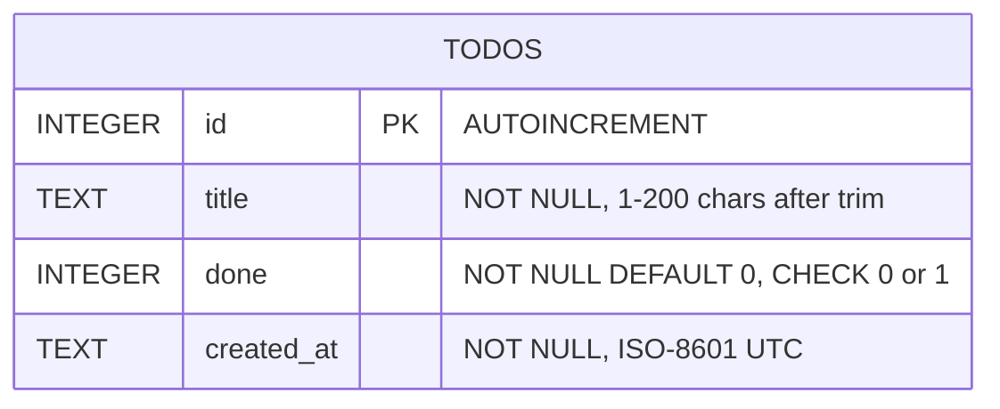
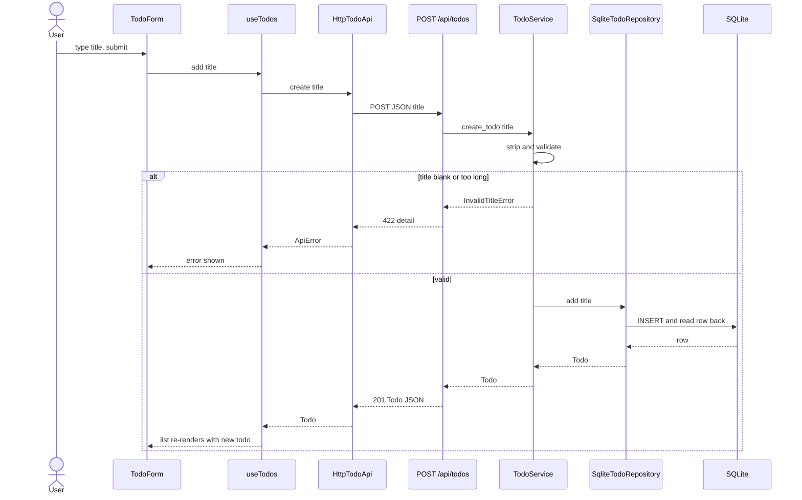

# Low-level design — todo-app

## Stack
| Layer | Choice | Why | Rejected alternative |
|---|---|---|---|
| Backend runtime | Python 3.13 + uv | Fixed by problem; 3.13 is installed locally | Python 3.14 (extra download, no gain here) |
| Web framework | FastAPI 0.162 + uvicorn | Fixed by problem | — |
| DB access | stdlib `sqlite3` behind a repository Protocol | One table, four queries; zero extra deps | SQLModel / SQLAlchemy (ORM overhead for one table) |
| Settings | pydantic-settings | Typed env config, per CONVENTIONS §5 | raw `os.environ` reads (untyped) |
| Frontend | React 19 + Vite 8 + TypeScript 6.0 | Fixed by problem; TS 6.0 because typescript-eslint 8.x supports `<6.1` only | TypeScript 7.0 (outside typescript-eslint peer range) |
| HTTP client | native `fetch` wrapped in `createHttpTodoApi` | Built in; 4 calls only | axios (extra dep, no need) |
| UI state | `useState` inside one `useTodos` hook | One list, one screen | TanStack Query, Zustand/Redux (unneeded cache/global store) |
| Dev serving | Two processes; backend allows Vite origin via CORS | As stated in HLD | Vite dev proxy (diverges from approved HLD) |

## Folder structure
```
todo-app/
├── scripts/check.sh                 # all checks, both halves (CONVENTIONS §6)
├── backend/
│   ├── pyproject.toml  uv.lock  .python-version  .env.example
│   ├── src/todo_app/
│   │   ├── main.py                  # create_app(): composition root
│   │   ├── config.py                # Settings
│   │   ├── api/          routes.py  schemas.py  deps.py  errors.py
│   │   ├── services/     todo_service.py
│   │   ├── repositories/ base.py  sqlite_todo_repository.py
│   │   └── domain/       models.py  errors.py
│   └── tests/  conftest.py  fakes.py  unit/  integration/
└── frontend/
    ├── package.json  package-lock.json  index.html  .env.example
    ├── vite.config.ts  tsconfig.json  eslint.config.js  .prettierrc.json  .dependency-cruiser.cjs
    └── src/
        ├── main.tsx                 # composition root: builds HTTP api, renders <App>
        ├── config.ts  App.tsx
        ├── components/ TodoForm.tsx  TodoList.tsx  TodoItem.tsx
        ├── hooks/      useTodos.ts
        └── api/        types.ts  httpTodoApi.ts      # tests colocated as *.test.ts(x)
```

## Modules / classes
**Backend** (package `todo_app`)
- `domain/models.py` — `@dataclass(frozen=True) class Todo: id: int; title: str; done: bool; created_at: datetime`
- `domain/errors.py` — `TodoError(Exception)`; `TodoNotFoundError(todo_id: int)`; `InvalidTitleError(reason: str)`
- `repositories/base.py` — `class TodoRepository(Protocol)`: `list_all() -> list[Todo]`, `add(title: str) -> Todo`,
  `set_done(todo_id: int, done: bool) -> Todo | None`, `delete(todo_id: int) -> bool`
- `repositories/sqlite_todo_repository.py` — `SqliteTodoRepository(db_path: Path)`; `init_schema() -> None` (idempotent
  `CREATE TABLE IF NOT EXISTS`); one connection per call via `contextlib.closing(sqlite3.connect(...))`; parameterised SQL only.
- `services/todo_service.py` — `TodoService(repo: TodoRepository)`: `list_todos() -> list[Todo]`;
  `create_todo(title: str) -> Todo` (strip; empty or > 200 chars → `InvalidTitleError`);
  `set_done(todo_id: int, done: bool) -> Todo`; `delete_todo(todo_id: int) -> None` (missing id → `TodoNotFoundError`)
- `api/schemas.py` — `TodoCreate(title: str)`, `TodoUpdate(done: bool)`, `TodoOut(id, title, done, created_at)` + `TodoOut.from_domain(todo)`
- `api/deps.py` — `get_todo_service(request: Request) -> TodoService` (returns `request.app.state.todo_service`)
- `api/errors.py` — `register_error_handlers(app: FastAPI) -> None`: `TodoNotFoundError → 404`, `InvalidTitleError → 422`, body `{"detail": str}`
- `api/routes.py` — `router = APIRouter(prefix="/api")`; one thin handler per endpoint below, service via `Depends(get_todo_service)`
- `config.py` — `Settings(BaseSettings)`: `db_path: Path`, `cors_origins: list[str]`, `log_level: str`; env prefix `TODO_`
- `main.py` — `create_app(settings: Settings | None = None) -> FastAPI`: repo → `init_schema()` → service → `app.state.todo_service`;
  adds CORS, router, error handlers. Module-level `app = create_app()` for `uvicorn todo_app.main:app`.

**Frontend**
- `api/types.ts` — `interface Todo { id: number; title: string; done: boolean; createdAt: string }`;
  `interface TodoApi { list(): Promise<Todo[]>; create(title: string): Promise<Todo>; setDone(id: number, done: boolean): Promise<Todo>; remove(id: number): Promise<void> }`;
  `class ApiError extends Error { readonly status: number }`
- `api/httpTodoApi.ts` — `createHttpTodoApi(baseUrl: string, fetchFn: typeof fetch = fetch): TodoApi`; maps `created_at` → `createdAt`; non-2xx → `ApiError(detail)`
- `hooks/useTodos.ts` — `useTodos(api: TodoApi): { todos; error: string | null; loading: boolean; add(title); toggle(todo); remove(id) }`;
  loads on mount, then updates state from each response (no refetch)
- `components/` — presentational, props only: `TodoForm({ onAdd })`, `TodoList({ todos, onToggle, onRemove })`, `TodoItem({ todo, onToggle, onRemove })`
- `App.tsx` — `App({ api }: { api: TodoApi })`: calls `useTodos(api)`, renders form, error line, list
- `config.ts` — `apiBaseUrl` from `import.meta.env.VITE_API_BASE_URL`, default `http://localhost:8000`

**Variation points (the only interfaces):** `TodoRepository` (SQLite; in-memory fake in tests) and `TodoApi` (HTTP; fake in hook/component tests).

## Data model / DB schema

List order `ORDER BY id ASC`. No migration tool; `init_schema()` runs at startup.

## API contracts
JSON only. `Todo` = `{"id": int, "title": str, "done": bool, "created_at": "ISO-8601"}`. Errors = `{"detail": ...}`.
| Method | Path | Request | Response | Errors |
|---|---|---|---|---|
| GET | `/api/health` | — | 200 `{"status": "ok"}` | — |
| GET | `/api/todos` | — | 200 `Todo[]` (id asc) | — |
| POST | `/api/todos` | `{"title": str}` | 201 `Todo` (`done=false`) | 422 missing / blank / over 200 chars |
| PATCH | `/api/todos/{id}` | `{"done": bool}` | 200 `Todo` | 404 not found; 422 bad body or id |
| DELETE | `/api/todos/{id}` | — | 204 empty | 404 not found |

## Key sequences


## Layer enforcement
**import-linter** (in `backend/pyproject.toml`)
```toml
[tool.importlinter]
root_package = "todo_app"
include_external_packages = true
[[tool.importlinter.contracts]]
name = "Layers point inward"
type = "layers"
layers = ["todo_app.main", "todo_app.api", "todo_app.services", "todo_app.repositories", "todo_app.domain"]
[[tool.importlinter.contracts]]
name = "Routes never touch storage"
type = "forbidden"
source_modules = ["todo_app.api"]
forbidden_modules = ["todo_app.repositories", "sqlite3"]
[[tool.importlinter.contracts]]
name = "Services and domain are framework-free"
type = "forbidden"
source_modules = ["todo_app.services", "todo_app.domain"]
forbidden_modules = ["fastapi", "starlette", "sqlite3", "todo_app.config"]
```
**dependency-cruiser** (`frontend/.dependency-cruiser.cjs`, `forbidden` rules, all `severity: "error"`)
- `no-circular` — `{ circular: true }`
- `api-is-leaf` — from `^src/api` to `^src/(components|hooks|App)`
- `hooks-no-ui` — from `^src/hooks` to `^src/(components|App)`
- `components-presentational` — from `^src/components` to `^src/(hooks|App|api/httpTodoApi)`
- `http-only-in-root` — from `^src/` (pathNot `^src/main\.tsx$|\.test\.tsx?$`) to `^src/api/httpTodoApi`

## Packages
Exact pins (`==` in pyproject, `--save-exact` in package.json); `uv.lock` and `package-lock.json` committed. Also in `.results/lld/packages.md`.
| Package | Version | Purpose | Alternative rejected |
|---|---|---|---|
| fastapi | 0.162.2 | HTTP framework | Flask (no typed validation) |
| uvicorn | 0.54.0 | ASGI server | hypercorn (less common) |
| pydantic | 2.14.3 | Request/response models | dataclasses (no validation) |
| pydantic-settings | 2.16.2 | Typed env settings | raw `os.environ` |
| pytest · pytest-cov | 9.2.0 · 7.1.0 | Tests + coverage gate (dev) | unittest (more boilerplate) |
| httpx | 0.28.1 | Needed by FastAPI `TestClient` (dev) | requests (TestClient uses httpx) |
| ruff | 0.17.4 | Lint + format (dev) | flake8 + black + isort |
| mypy | 2.4.1 | Strict types (dev) | pyright (Node dep in Python half) |
| import-linter | 2.16 | Layer contracts (dev) | review-only enforcement |
| radon | 6.0.1 | Complexity report (dev) | ruff C901 alone |
| react · react-dom | 19.3.1 · 19.3.1 | UI | — (fixed by problem) |
| vite · @vitejs/plugin-react | 8.3.6 · 6.3.0 | Dev server + build (dev) | Create React App (deprecated) |
| typescript | 6.0.3 | Types (dev) | 7.0.2 (outside typescript-eslint range) |
| @types/react · @types/react-dom | 19.3.0 · 19.3.0 | React types (dev) | — |
| eslint · @eslint/js | 10.14.0 · 10.0.1 | Lint (dev) | Biome (no typescript-eslint strict parity) |
| typescript-eslint | 8.72.1 | Strict TS rules (dev) | — |
| eslint-plugin-react-hooks | 7.1.1 | Hooks rules (dev) | none (hook-deps bugs slip through) |
| prettier | 3.9.10 | Format (dev) | ESLint Stylistic |
| dependency-cruiser | 18.7.2 | Layer rules (dev) | eslint-plugin-boundaries |
| vitest · @vitest/coverage-v8 | 5.1.0 · 5.1.0 | Tests + coverage (dev) | Jest (separate transform setup) |
| @testing-library/react · /dom | 16.3.3 · 10.4.2 | Component tests (dev) | Enzyme (unmaintained) |
| jsdom | 31.0.0 | DOM for vitest (dev) | happy-dom (less complete) |

## Config & secrets
No secrets. `.env` is git-ignored; keys documented in each half's `.env.example`.
| Var | Half | Default | Purpose |
|---|---|---|---|
| `TODO_DB_PATH` | backend | `./todo.db` | SQLite file |
| `TODO_CORS_ORIGINS` | backend | `["http://localhost:5173"]` | Allowed browser origins |
| `TODO_LOG_LEVEL` | backend | `INFO` | Logger level |
| `VITE_API_BASE_URL` | frontend | `http://localhost:8000` | Backend base URL |

Run: `cd backend && uv run uvicorn todo_app.main:app --reload` · `cd frontend && npm run dev`.
Needs Node ≥ 22.12 (vitest 5, jsdom 31 need ≥ 22.22); local Node 22.23 OK. Add `*.db` to `.gitignore` (env-setup).
